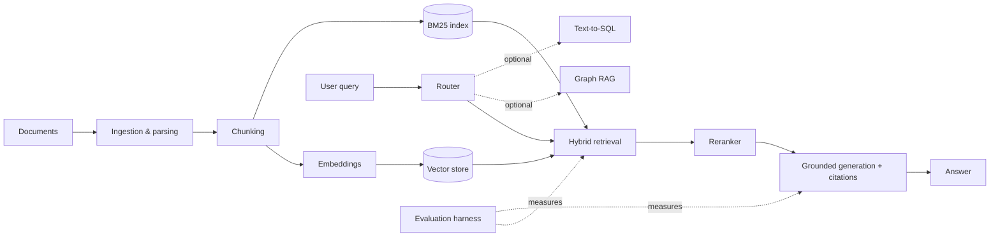

# advanced-rag

A modular, evaluation-driven **Retrieval-Augmented Generation (RAG)** system,
built incrementally so that every added technique is measured against a baseline.

> **Status: Milestone 0 — repository setup.** No RAG functionality is
> implemented yet. Sections below marked *planned* describe intended design,
> not working features.

## Problem

LLMs answer fluently but can't see private or recent documents, and they
hallucinate. RAG retrieves relevant passages first and grounds the answer in
them, with citations a user can check. This project explores which retrieval
techniques actually improve answer quality, and at what latency and cost.

## Goals

- Ingest and parse documents while preserving original text and metadata.
- Compare chunking strategies, embedding models, vector and BM25 retrieval,
  hybrid fusion and reranking against a fixed evaluation set.
- Route queries to the right retrieval strategy (optionally Graph RAG or
  Text-to-SQL).
- Generate grounded answers with verifiable source citations.
- Measure retrieval quality, answer correctness, faithfulness, latency and cost.
- Serve via FastAPI with a minimal Streamlit demo UI; package with Docker.

## Planned architecture



Each box will be a separate module behind a small interface, so strategies can
be swapped and compared without rewriting the pipeline.

## Technology

| Area | Choice | Status |
|---|---|---|
| Language | Python 3.12 | decided |
| Environment & dependencies | uv (`pyproject.toml` + `uv.lock`) | decided |
| Version control | Git, branch `main` | decided |
| Vector store | ChromaDB (current preference) | to confirm at milestone |
| Demo UI | Streamlit | decided, not built |
| LLM, embeddings, reranker, chunking, BM25/fusion, router | — | pending |
| Orchestration & tracing | LangChain, LangGraph, LangSmith (optional) | pending |
| API / deployment | FastAPI, Docker | pending |

## Setup (Windows PowerShell)

Prerequisites: Python 3.12 and [uv](https://docs.astral.sh/uv/).

```powershell
cd C:\dev\advanced-rag
uv sync                       # create/refresh .venv from pyproject.toml + uv.lock
.\.venv\Scripts\Activate.ps1  # optional: activate the environment
python -c "import rag_app; print(rag_app.__version__)"
```

Without activating, prefix commands with `uv run`, e.g. `uv run python ...`.

If activation is blocked by execution policy, run once:
`Set-ExecutionPolicy -Scope CurrentUser RemoteSigned`.

Configuration: copy `.env.example` to `.env` and fill in values once variables
are introduced. `.env` is git-ignored.

## Project structure

```
advanced-rag/
├── CLAUDE.md          # working rules for AI-assisted development
├── README.md
├── pyproject.toml     # project metadata and dependencies
├── .python-version    # interpreter pin used by uv
├── .env.example       # environment variable template (no secrets)
├── .gitignore
├── .gitattributes     # LF line endings in the repo
└── src/rag_app/       # application package
```

Directories such as `tests/`, `docs/`, `evals/` and `data/` (git-ignored) are
added in the milestone that first needs them.

## Milestones (planned)

0. Repository setup ← *current*
1. Document ingestion and chunking baseline, with unit tests and a small
   hand-written evaluation set (questions + expected source passages)
2. Embeddings and vector retrieval baseline, with retrieval metrics
3. BM25 and hybrid fusion, compared against the baseline
4. Reranking
5. Grounded generation with citation validation
6. LangGraph workflow: routing, grading, bounded retries
7. FastAPI service and Streamlit demo UI
8. Optional: Graph RAG, Text-to-SQL, LangSmith tracing
9. Docker and CI/CD

## Evaluation (planned)

Retrieval: Recall@k, Precision@k, MRR, nDCG. Answers: correctness,
faithfulness, citation validity. Operational: latency, token usage, cost.
Strategies are compared on the same dataset; only measured results are reported.

## Security considerations

- Secrets only in `.env`; never committed or logged.
- Private documents, vector stores and model weights are git-ignored.
- Retrieved text is treated as untrusted input (prompt-injection risk).
- Any LLM-generated SQL will be validated and run read-only.
- Choosing a hosted LLM or embedding API sends document text to that provider;
  this will be decided explicitly.

## Known limitations

Nothing is implemented yet beyond the package skeleton.
